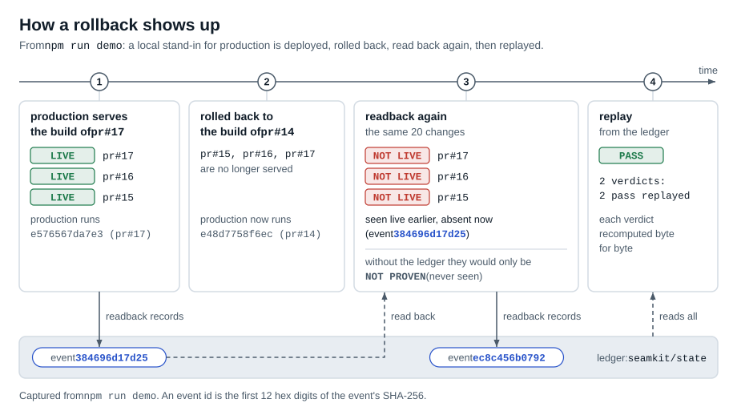
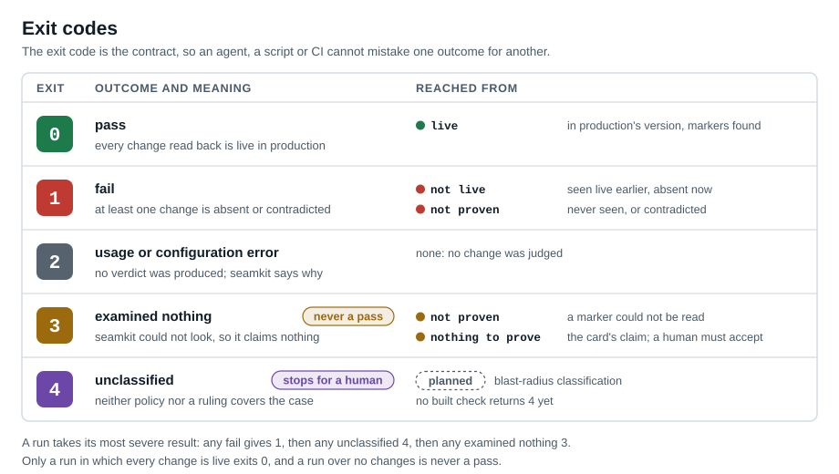
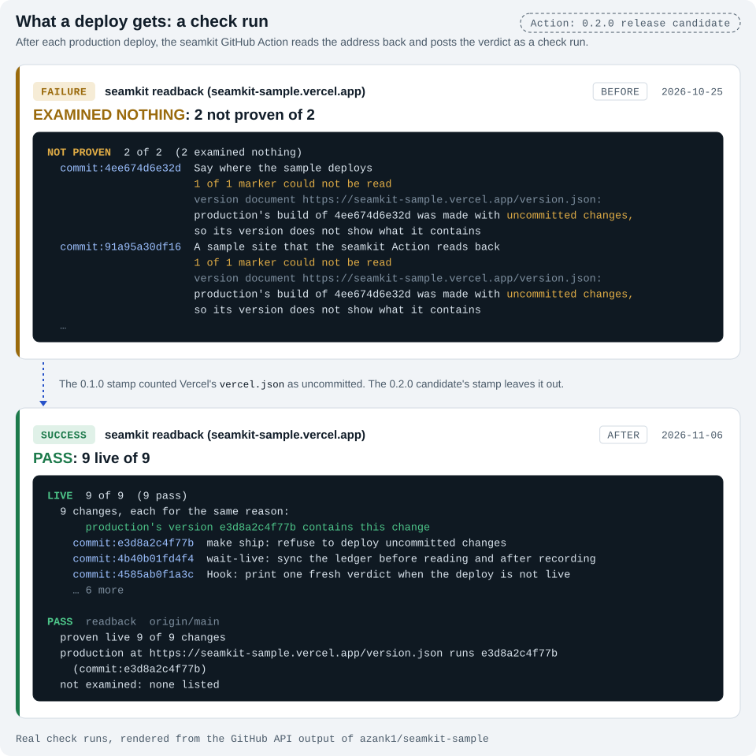
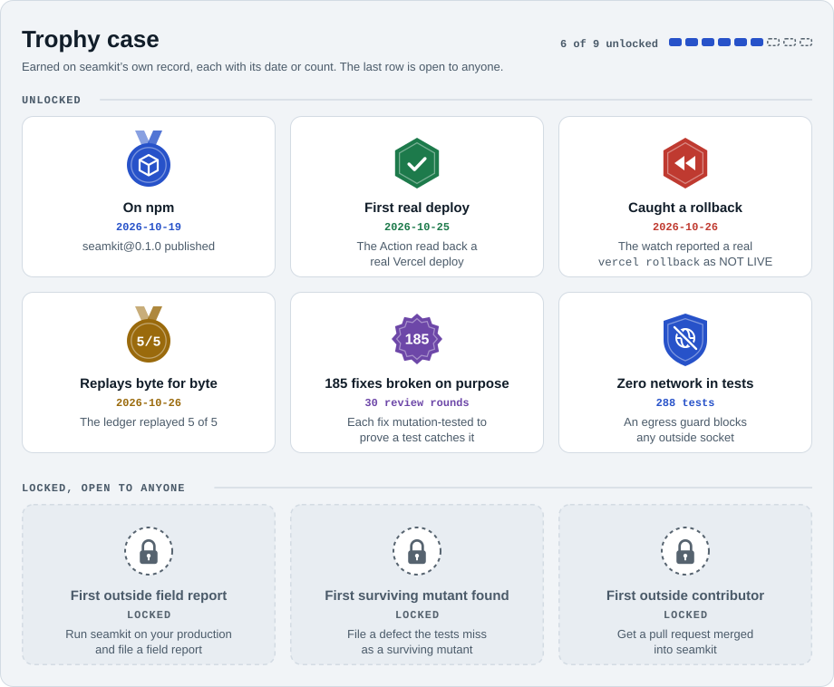
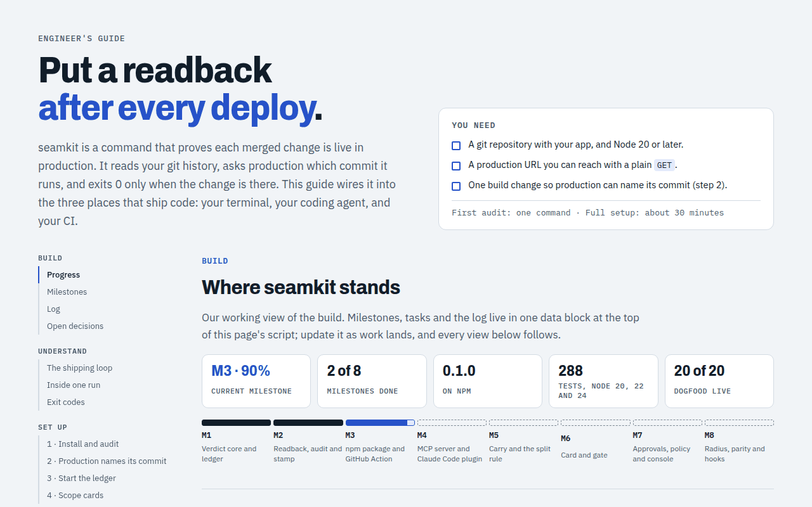

<div align="center">

# seamkit

**Is your merged change actually live in production? seamkit checks, and answers with an exit code.**

[](https://github.com/azank1/seamkit/actions/workflows/ci.yml)
[](https://www.npmjs.com/package/seamkit)
[](LICENSE)
[](#development)
<br>
[](#development)
[](https://seamkit.vercel.app)
[](#how-it-works)
[](CONTRIBUTING.md)
[](#outcomes-and-exit-codes)

[Quick start](#quick-start) · [How it works](#how-it-works) · [Use it](#use-it) · [Proven live](#proven-live) · [Levels](#levels) · [Break the referee](#break-the-referee) · [Setup guide](https://azank1.github.io/seamkit/) · [Research](https://seamkit.vercel.app)

</div>

When AI agents write most of the code, changes merge faster than anyone can watch them ship. A green merge is not a
deploy, a deploy is not always the build you think it is, and a check that looked at nothing should never come back as a
pass. seamkit is a set of deterministic production checks for small teams in that position. It reads production
read-only, compares what it serves with your git history, and records the evidence in your own repository. No model runs
inside it, and agents, CI and humans all get the same verdicts.

<!-- claim C-P0 -->
For every merged change, seamkit reads production back for the deployable units you declared and gives a verdict that lists what it did not examine and never passes when it examined nothing. The judgement replays byte for byte from the observations recorded in your own git.

## Quick start

```sh
cd your-repo
npx seamkit audit --url https://your.app
```

<p align="center">
  
</p>

The audit takes the latest changes merged into your default branch and asks production which commit it runs. Every
change is then reported as **live**, **not live**, **not proven** or **nothing to prove**, followed by what to fix for
each change it could not prove. Both runs above are real: the first against seamkit's own research page, the second
against a site that does not say what it runs. Not knowing is never reported as a pass.

To make production say what it runs, write a version document at build time:

```sh
npx seamkit stamp --out public/version.json   # before the build; most bundlers copy public/ into the output
```

or answer `/api/version` with `{"commit": "<full commit id>"}`. [Make production say what it runs](docs/stamp.md)
covers both, the fields seamkit reads, and what stamp does on Vercel.

## See it catch a rollback

```sh
git clone https://github.com/azank1/seamkit && cd seamkit
npm ci && npm run demo
```

<p align="center">
  
</p>

The demo seeds an invented notes service with twenty pull requests written as if by agents, serves the build of pull
request 17 from a local fake production and records a readback, then rolls production back to pull request 14 and
reads back again. The second run sorts the twenty changes into live 9, not live 3, not proven 5 and nothing to prove 3,
and replay recomputes both runs byte for byte. Two of its changes show the common mistakes: pull request 11's marker
names a component that exists only in a source comment, and pull request 12 names a database object, which this version
cannot read yet. The demo's history is seeded with fixed identities and dates, so its commit ids are the same on every
machine, and its test pins every state. It needs no network and no account.

## How it works

<picture>
  <source media="(prefers-color-scheme: dark)" srcset="docs/assets/architecture-dark.svg">
  
</picture>

Three steps, each with a plain artefact you can inspect:

1. **Stamp.** At build time, `seamkit stamp` writes the commit the build was made from, and whether the tree was clean,
   into a version document that production serves. A change can also carry a `seamkit-card` in its pull request that
   names text the built output must contain. See [readback states and scope cards](docs/cards.md).
2. **Read back.** After a deploy, seamkit reads production with `GET` requests only and walks the first-parent history
   of the default branch, one change per merged pull request or direct commit. A change is live when the commit
   production runs contains it and every marker it names is served.
3. **Record.** Every run is written to a `seamkit/state` branch in your repository, one file per event named by the
   SHA-256 of its content. That history is what lets a later run say a change was live and has left production. See
   [the ledger](docs/ledger.md).

<picture>
  <source media="(prefers-color-scheme: dark)" srcset="docs/assets/rollback-dark.svg">
  
</picture>

## Outcomes and exit codes

Every check returns one of four outcomes, and the exit code says which, so a script or an agent cannot mistake one for
another.

<picture>
  <source media="(prefers-color-scheme: dark)" srcset="docs/assets/outcomes-dark.svg">
  
</picture>

| Exit code | Outcome |
|---|---|
| 0 | pass |
| 1 | fail |
| 2 | usage or configuration error; no verdict was produced |
| 3 | examined nothing: seamkit could not look, so it does not claim anything |
| 4 | unclassified, which stops for a human |

`--json` prints one JSON document per run, holding the outcome, the exit code and every verdict with its reasons,
what was examined and what was not.

## Use it

### From a terminal

`seamkit audit` is the place to start. `seamkit readback` is the same check without the advice, for scripts, with
`--pr <n>` for one pull request and `--deployed <rev>` to judge the deploy of one commit. `seamkit replay` recomputes
every recorded verdict, and `seamkit state` starts, verifies and syncs the ledger. `npx seamkit --help` lists them all.

### From an agent

The exit code is the contract, so an agent needs one instruction, for example in `AGENTS.md` or `CLAUDE.md`:

```markdown
After a deploy, run `npx seamkit readback --url https://your.app --pr <number> --json`.
The change is shipped only when it exits 0. Exit 1 means it is not live or not proven. Exit 3 means nothing
was proven: production or a marker could not be read, the card says there is nothing to prove, or the pull
request was not found. Report the reasons; never call a change done on any other exit code.
```

Agents that speak MCP can ask through tools instead. `seamkit mcp --url https://your.app` serves `audit`,
`readback`, `replay` and `ledger_verify` as read-only tools whose answers are the CLI's JSON, byte for byte; an agent
can only pick among the production addresses it was started with, and it records nothing. In Claude Code, the plugin
sets it up:

```text
/plugin marketplace add azank1/seamkit
/plugin install seamkit@seamkit
```

The MCP server and the plugin are built and tested, and ship with the next release after 0.2.0; neither is on npm yet.
[Use seamkit from an MCP client](docs/mcp.md) covers other clients and `seamkit tools --format openai|anthropic|gemini`
for model APIs called directly.

### In CI

The seamkit Action reads production back once a deploy succeeds and posts the verdict as a check run on the deployed
commit. The Action and `readback --deployed` ship with 0.2.0, a release candidate in
[draft PR #6](https://github.com/azank1/seamkit/pull/6) that is not yet tagged or on npm. On Vercel, the project's
`deployment_status` Events setting (Settings, Git) must be on, and a new project can start with it off.

```yaml
# .github/workflows/readback.yml
name: readback
on: deployment_status
permissions:
  contents: write   # to record verdicts on the seamkit/state branch
  checks: write     # to post the check run
jobs:
  readback:
    if: github.event.deployment_status.state == 'success' && github.event.deployment.environment == 'Production'
    concurrency:
      group: seamkit-readback-${{ github.event.deployment.environment }}
      cancel-in-progress: false
    runs-on: ubuntu-latest
    steps:
      - uses: actions/checkout@v7
        with:
          fetch-depth: 0   # readback decides by commit ancestry, so it needs the history
      - uses: azank1/seamkit@v0.2.0
        with:
          url: https://your.app
          ledger: 'true'   # start the ledger on the first run, so a rollback shows as not live
```

<picture>
  <source media="(prefers-color-scheme: dark)" srcset="docs/assets/checkrun-dark.svg">
  
</picture>

The first of those check runs is how seamkit found that Vercel writes `vercel.json` into the checkout during the
build, which made every 0.1.0 stamp read as a build with uncommitted changes. 0.2.0 stamps leave that file out.
[Use seamkit in CI](docs/ci.md) covers the scheduled watch that catches rollbacks and hand deploys, every input, Vercel's
settings, deploys from your own workflow, and the recipe for any other CI.

## Proven live

Real readbacks against production, each run by its owner. Add yours with a [field report](https://github.com/azank1/seamkit/issues/new?template=field-report.yml),
and it goes on this board once confirmed.

| Production | Host | Run | Verdict | Date |
|---|---|---|---|---|
| seamkit.vercel.app | Vercel | `seamkit audit --last 8` | PASS, live 8 of 8 | 2026-11-06 |
| seamkit-sample.vercel.app | Vercel | the seamkit Action, a check run per deploy | PASS, live 9 of 9 | 2026-11-06 |
| commit.city | Vercel | `seamkit audit` | PASS, live 20 of 20 | 2026-10-15 |

Before commit.city served its commit, the same audit proved 0 of 20 changes and exited 3, with advice on how to fix
that.

<picture>
  <source media="(prefers-color-scheme: dark)" srcset="docs/assets/trophies-dark.svg">
  
</picture>

## Levels

<picture>
  <source media="(prefers-color-scheme: dark)" srcset="docs/assets/roadmap-dark.svg">
  
</picture>

seamkit 0.1 is the command line tool: `audit`, `readback`, `stamp`, `replay` and `state`. 0.2 adds the GitHub Action,
which reads back after every deploy and reports a check run, and `readback --deployed`, which judges a deploy by the
commit it shipped. Both are tested on Node 20, 22 and 24 on Linux. Level 3, `seamkit mcp` and the Claude Code plugin, is
built and tested on a branch: Claude Code, as an MCP client, has run an audit through it and received the verdicts and
the outcome. It is not released yet. The locked levels are the rest of the roadmap, in order, and none of them is built. The design is in [`docs/architecture.md`](docs/architecture.md), and the survey of existing tools,
with what each one does and does not cover, is in [`docs/prior-art.md`](docs/prior-art.md).

## Break the referee

A referee is only as good as the tests behind it. Every fix in seamkit's review rounds is broken on purpose, by putting
the defect back, to prove that a test turns red; 185 fixes have been checked that way, and the
[research page](https://seamkit.vercel.app) shows each round. If you find a change to the code that gives a wrong
verdict while every test still passes, that is a real gap. Report it as a
[surviving mutant](https://github.com/azank1/seamkit/issues/new?template=surviving-mutant.yml), and once confirmed it
goes in the [Hall of fame](HALL_OF_FAME.md), with the fix and the test that now catches it.

Good places to start are the readback check in `packages/core/src/checks`, the card parser in
`packages/formats/src/card.ts`, and the version document reader in `packages/adapters/src/version.ts`. Bugs where a verdict looks wrong go in a
[bug report](https://github.com/azank1/seamkit/issues/new?template=bug.yml) with the `--json` output.

## Documentation

| Page | What it covers |
|---|---|
| [Setup guide](https://azank1.github.io/seamkit/) | diagrams, copy-in recipes for terminals, agents and CI, and the build tracker |
| [Make production say what it runs](docs/stamp.md) | the version document, `seamkit stamp`, and Vercel's build |
| [Use seamkit in CI](docs/ci.md) | the Action, the scheduled watch, every input, and other CI systems |
| [Readback states and scope cards](docs/cards.md) | how each change is judged, and how a card names evidence |
| [The ledger](docs/ledger.md) | the `seamkit/state` branch, replay, and what is recorded |
| [Use seamkit from an MCP client](docs/mcp.md) | the MCP server, the Claude Code plugin, and tool definitions for model APIs |
| [Architecture](docs/architecture.md) | the design, the threat model and the milestones |
| [Prior art](docs/prior-art.md) | where existing tools stop |
| [Research](https://seamkit.vercel.app) | the review rounds, the figures and the real deploys |

<p align="center">
  <a href="https://azank1.github.io/seamkit/"></a>
</p>

## Development

```sh
npm ci
npm test             # 307 tests, using temporary repositories and a local fake production
npm run demo         # add -- --keep to keep the demo repository
npm run pack:cli     # builds the npm package into release/seamkit
npm run smoke:pack   # installs that package into an empty project and runs it
npm run pack:action  # rebuilds the Action's committed bundle; commit it with the source that changed it
node scripts/supply-chain.mjs  # licences, shipped dependencies and notices (after both pack commands)
node scripts/claims.mjs        # every public claim in claims.json, with the tests that prove it
```

Every test process loads `scripts/no-egress.mjs`, so a test that opens a socket to anything but this machine fails:
seamkit's verdicts never call a model or an outside service, and the suite proves it.

See [`CONTRIBUTING.md`](CONTRIBUTING.md) to contribute and [`SECURITY.md`](SECURITY.md) to report a vulnerability.

<a href="https://star-history.com/#azank1/seamkit&Date">
  <picture>
    <source media="(prefers-color-scheme: dark)" srcset="https://api.star-history.com/svg?repos=azank1/seamkit&type=Date&theme=dark">
    
  </picture>
</a>

Licensed under the Apache License, Version 2.0. See [`LICENSE`](LICENSE).
